# Twitch-Moderation: Menschlich, sicher und verantwortungsvoll

**Erstfassung: Mai 2026 · Laufende Bearbeitung: Mai bis Oktober 2026 · GitHub-Upload: 1. November 2026**

Ein praxisnaher Leitfaden für Menschen, die Twitch-Kanäle moderieren, Moderation verstehen oder sich erstmals mit den Werkzeugen auseinandersetzen möchten.

> **Hinweis zu den Bildern:** Im Hauptteil sind nur die wichtigsten Screenshots direkt eingebunden. **[Ganz unten](#erweiterte-bildansichten)** findest du zusätzliche Ansichten zu den beschriebenen Funktionen, darunter Widgets, Dashboard, iPhone und Chatbefehle. Die Beispiele zeigen den Stand der dokumentierten Oberfläche. Twitch kann Funktionen und Bezeichnungen ändern. Identifizierende Inhalte wurden für die Veröffentlichung abgedeckt oder aus den Bildausschnitten entfernt.

## Inhalt

1. [Was gute Moderation ausmacht](#1-was-gute-moderation-ausmacht)
2. [Teamarbeit, Grenzen und Kommunikation](#2-teamarbeit-grenzen-und-kommunikation)
3. [Moderieren ohne Mod-Ansicht](#3-moderieren-ohne-mod-ansicht)
4. [Moderieren im normalen PC-Chat](#4-moderieren-im-normalen-pc-chat)
5. [Chatbefehle als Werkzeug](#5-chatbefehle-als-werkzeug)
6. [Die Mod-Ansicht am PC](#6-die-mod-ansicht-am-pc)
7. [Mod-Ansicht auf dem iPhone](#7-mod-ansicht-auf-dem-iphone)
8. [Stream-Manager und Kanal-Dashboard](#8-stream-manager-und-kanal-dashboard)
9. [AutoMod, Regeln und Kanalmodi](#9-automod-regeln-und-kanalmodi)
10. [Community, Lurker, Bots und Botlisten](#10-community-lurker-bots-und-botlisten)
11. [Followbotting, Viewbotting und Angriffe](#11-followbotting-viewbotting-und-angriffe)
12. [Praxisbeispiele und Verhältnismäßigkeit](#12-praxisbeispiele-und-verhältnismäßigkeit)
13. [Quellen und Weiterführendes](#13-quellen-und-weiterführendes)
14. [Erweiterte Bildansichten](#erweiterte-bildansichten)

---

## 1. Was gute Moderation ausmacht

Moderator auf Twitch zu sein, kann manchmal eine schwierige und herausfordernde Aufgabe sein. Man übernimmt Verantwortung für den Chat und die Community, soll den Streamer unterstützen und muss gelegentlich Entscheidungen treffen, für die es keine perfekte Lösung gibt. Das kann gerade am Anfang überfordernd wirken. **Wenn man die grundlegenden Funktionen, die Regeln und die eigene Rolle kennt, wird vieles einfacher.**

Moderation ist allerdings weit mehr als das Bedienen von Knöpfen. Hinter Benutzernamen stehen Menschen mit eigenen Erfahrungen, Geschichten, Empfindungen und Sichtweisen. Genau das sollte beim Moderieren immer mitgedacht werden. Wer einen Chat betreut, begleitet eine Community. Ein respektvoller Umgang ist dabei nicht weniger wichtig als klare Grenzen.

### Menschlichkeit statt unnötiger Härte

Ein guter Moderator muss nicht besonders streng sein, um seine Aufgabe gut zu erfüllen. Verständnis, Geduld, Fingerspitzengefühl und eine faire Einschätzung der Situation sind oft viel wichtiger. Nicht jede Meinungsverschiedenheit ist gleich ein Streit, nicht jede unglückliche Formulierung eine Provokation und nicht jeder Fehler muss mit Timeout oder Bann beantwortet werden.

Es kann sinnvoller sein, zunächst freundlich nachzufragen, etwas zu erklären oder auf die geltenden Regeln hinzuweisen. Manchmal genügt bereits eine ruhige Nachricht, um eine Diskussion wieder in eine positive Richtung zu lenken. Das heißt nicht, dass Moderatoren alles hinnehmen sollen. Bei Belästigungen, gezielten Angriffen oder anhaltenden Regelverstößen sind klare Maßnahmen richtig und notwendig. **Entscheidend ist, angemessen zu handeln, nicht möglichst hart.**

### In Diskussionen ein positiver, vermittelnder Faktor sein

Diskussionen gehören zu lebendigen Communities. Unterschiedliche Meinungen können interessant sein und zum Austausch beitragen. Die Aufgabe eines Moderators ist nicht, jede abweichende Meinung zu unterbinden. Sinnvoller ist es, auf einen respektvollen Ton zu achten und zu verhindern, dass sich Menschen gegenseitig hochschaukeln.

Im Idealfall geht ein Moderator aus einer schwierigen Diskussion als positiver, vermittelnder Faktor hervor. Er muss dabei nicht immer das letzte Wort haben. Wenn ein Moderator selbst Teil der Auseinandersetzung wird, sich persönlich angegriffen fühlt oder merkt, dass die eigene Stimmung seine Entscheidung beeinflusst, ist es besser, sich zurückzunehmen. Ein anderes Teammitglied kann dann übernehmen und die Situation unvoreingenommener beurteilen.

### Den Streamer vertreten, nicht ersetzen

Das Ungünstigste ist häufig, wenn sich ein Streamer mitten in seiner Unterhaltung mit einem vermeidbaren Chatkonflikt beschäftigen muss, weil das Moderationsteam die Situation nicht mehr auffangen kann. Schließlich soll der Streamer sich auf den Stream und seine Community konzentrieren können.

Es gibt aber selbstverständlich Fälle, in denen er eingreifen muss oder selbst eingreifen möchte. Das ist vollkommen in Ordnung, denn **im eigenen Kanal hat der Streamer das letzte Wort**. Moderatoren sollen ihn vertreten können. Dazu müssen sie seine Vorstellungen, den Charakter seiner Community und die gemeinsam vereinbarten Regeln kennen. Sie sollen nicht aus Eigeninitiative neue Regeln schaffen, die möglicherweise gar nicht in seinem Sinne sind.

### Auch Moderatoren können Fehler machen

Moderatoren sind ebenfalls Menschen. Man kann eine Nachricht missverstehen, einen Kontext übersehen oder eine Entscheidung später anders bewerten. Wichtig ist, darüber sprechen zu können, Fehler zu korrigieren und aus Erfahrungen zu lernen. Ein gutes Moderationsteam misst seine Arbeit nicht daran, wie viele Personen es gesperrt hat, sondern auch daran, wie viele schwierige Situationen ohne unnötige Eskalation gelöst werden konnten.

## 2. Teamarbeit, Grenzen und Kommunikation

### Miteinander reden, statt allein entscheiden

Moderation ist Teamarbeit. Es hilft enorm, sich regelmäßig auszutauschen: **Wie seht ihr das? Hättet ihr in derselben Situation gleich reagiert? Habe ich etwas übersehen?** Andere Moderatoren haben vielleicht einen anderen Blick auf die Nachricht oder kennen den Hintergrund eines Gesprächs. Diese Unterschiede müssen kein Problem sein. Sie können helfen, einheitlicher und gerechter zu moderieren.

Bei grundlegenden Regeln sollte auch der Streamer einbezogen sein. Wenn Entscheidungen im Team unterschiedlich ausfallen, ist es besser, sich abzustimmen, als dass jeder stillschweigend seine ganz persönlichen Grenzen zur allgemeinen Kanalregel macht. Im Zweifelsfall darf eine Situation auch an andere Teammitglieder übergeben werden.

### Keine ungefragte Werbung in anderen Streams

Wer bei einem Streamer moderiert, sollte sich auch in anderen Kanälen respektvoll verhalten. Ungefragt Werbung für den eigenen Kanal, den Kanal eines Freundes oder den Streamer zu machen, den man betreut, kann störend wirken. Andere Communities sind keine Werbeflächen.

Anders ist es, wenn ein Streamer **ausdrücklich nach Raid-Vorschlägen fragt**. Dann kann eine Empfehlung absolut passend sein, besonders wenn das Spiel, die Kategorie, die Stimmung oder die Community zum aktuellen Stream passen. Entscheidend ist, dass die Empfehlung erwünscht ist und sich natürlich in die Situation einfügt.

### Nicht jedes Emote bedeutet für jeden dasselbe

Ein gutes Beispiel für vorschnelle Auslegung ist der einfache Zwinkersmiley `;)`. Für die eine Person ist er freundlich, für die andere scherzhaft oder ironisch. Andere können ihn als Flirtversuch oder unangenehme Anspielung empfinden. Keine dieser Interpretationen gilt automatisch für alle.

Gerade deshalb wäre es problematisch, wenn ein Moderator diesen Smiley ohne Absprache mit dem Streamer einfach als blockierten Begriff in den AutoMod-Einstellungen hinterlegt. Vielleicht weiß der Streamer nicht einmal, dass diese Regel existiert. Und vielleicht werden dadurch Nachrichten zurückgehalten, die überhaupt nicht problematisch gemeint waren.

Das bedeutet nicht, dass man Belästigungen ignorieren sollte. Wenn sich jemand wiederholt unangenehm verhält, Grenzen missachtet oder gezielt provoziert, muss man reagieren. Aber zwischen einem einzelnen Zwinkersmiley und einem tatsächlichen Übergriff besteht ein Unterschied. **Nicht nur den Ausdruck betrachten, sondern auch Zusammenhang, Verhalten und Wiederholung.**

### Vertrauen, Humor und Insider-Witze zwischen Streamer, Moderatoren und Zuschauern

Wie ein Moderator mit dem Streamer umgeht, ist ebenfalls eine Grundlage des gegenseitigen Vertrauens. Ein Moderationsteam soll seinen Streamer unterstützen, muss aber deshalb nicht immer ernst oder förmlich auftreten. Manchmal wird miteinander gescherzt, manchmal trollt ein Moderator den Streamer auf freundschaftliche Weise, und manchmal entstehen Insider-Witze, die eine Community über lange Zeit begleiten.

Es gibt auch Zuschauer, die ihren Streamer schon lange kennen und genau wissen, mit welchen Sprüchen sie ihn humorvoll aufziehen können. Vielleicht reagiert der Streamer darauf regelmäßig mit einem kleinen Timeout. Zwischen den Beteiligten ist längst klar, dass das keine ernst gemeinte Bestrafung, sondern ein gemeinsamer Running Gag ist. Solcher Spaß kann zu einer vertrauten, lebendigen Community gehören.

**Wichtig bleibt immer, dass der Spaß von allen Beteiligten verstanden und mitgetragen wird.** Niemand sollte mit Moderationsrechten bloßgestellt werden oder einen Timeout bekommen, nur weil andere ihn lustig finden. Ein scherzhafter Umgang mit einer vertrauten Person ist keine allgemeine Erlaubnis, bei beliebigen Zuschauern genauso zu handeln.

#### Wie man den Spaß nach außen vermittelt

Für jemanden, der zum ersten Mal zusieht, kann ein solcher Timeout zunächst hart oder unangenehm wirken. Die Art, wie der Streamer reagiert, verändert aber oft den Eindruck: Ein langjähriger Zuschauer bringt wieder seinen frechen Spruch, der Streamer grinst, lacht und sagt vielleicht: *„Du kennst das Spiel!“* Schon folgt der scherzhafte Timeout. Durch Tonfall, Lachen und Reaktionen im Chat wird für andere viel eher erkennbar, dass beide das als Spaß verstehen.

Nicht jede Situation, die auf den ersten Blick streng aussieht, ist also tatsächlich so gemeint. Gleichzeitig darf man nicht erwarten, dass neue Zuschauer die gemeinsame Vorgeschichte kennen. Wenn ein Scherz missverständlich wirkt, kann eine kurze, freundliche Erklärung helfen. Der Streamer und das Team prägen mit ihrem Verhalten auch, wie die Community von außen wahrgenommen wird.

#### Die Grenze zwischen Running Gag und echter Sanktion

Humor funktioniert nur, solange persönliche Grenzen respektiert werden. Ein Spruch, über den jemand gestern gelacht hat, kann an einem anderen Tag unangenehm sein. Es lohnt sich, auf Reaktionen zu achten und nachzufragen, wenn unklar ist, ob noch alle Spaß haben. Ein einvernehmlicher Insider-Timeout unterscheidet sich deutlich von einer notwendigen Moderationsmaßnahme bei einer Regelverletzung.

Moderatoren sollten deshalb **Kontext, Beziehung und Stimmung** kennen, ohne Zuschauer in eine Gruppe mit Sonderrechten und eine Gruppe ohne Respekt aufzuteilen. Ein vertrauter Umgang darf kein Freibrief für Belästigungen werden. Umgekehrt muss auch nicht jeder harmlose Insider-Witz wie ein ernsthafter Regelverstoß behandelt werden.

**Gute Moderation lässt gemeinsames Lachen zu, erkennt aber auch rechtzeitig, wann der Spaß aufhört.**

### Vertrauen und Verantwortung

Ein Moderator ist nicht einfach nur ein Zuschauer mit zusätzlichen Knöpfen. Er bekommt Vertrauen und teilweise weitreichende Rechte. Das macht den regelmäßigen Austausch so wichtig: Entscheidungen und Änderungen sollten nachvollziehbar sein und sich an gemeinsamen Regeln orientieren. Besonders bei kanalweiten Einstellungen ist die Frage nicht nur: *Kann ich das ändern?*, sondern auch: *Soll ich das ändern, und ist es mit dem Streamer abgesprochen?*

## 3. Moderieren ohne Mod-Ansicht

**Niemand muss die Mod-Ansicht benutzen.** Es gibt mehrere Wege, einen Twitch-Kanal zu moderieren:

| Oberfläche | Wann sie praktisch ist |
|---|---|
| **Normaler Chat** | Chat beobachten, Symbole bei Nachrichten nutzen, `/`-Befehle eingeben |
| **Mod-Ansicht** | Mehrere Moderations-Widgets, AutoMod, Aktionen und Community parallel im Blick |
| **Stream-Manager** | Stream-Vorschau, Aktivitätsfeed, Chat und Stream-Schnellaktionen |
| **Creator-Dashboard** | Erweiterte Kanaleinstellungen, soweit für die jeweilige Rolle zugänglich |

Das ist keine Rangfolge. Ein erfahrener Moderator kann ganz bewusst im normalen Chat bleiben. Entscheidend ist, dass die Arbeitsweise zur Aufgabe passt.

## 4. Moderieren im normalen PC-Chat

Im Browser, beispielsweise Google Chrome, den Chat eines Kanals öffnen, in dem du Moderator bist. Über das **Zahnrad** gelangst du zu den Chat-Einstellungen. Dort kannst du zwischen den normalen Einstellungen und den **Mod-Einstellungen** wechseln.

Unter **Meine Präferenzen** sind zwei Optionen besonders nützlich:

- **Mod-Symbole anzeigen:** Moderationssymbole bei Nachrichten sichtbar machen.
- **Moderationsaktionen anzeigen:** Direkte Moderationsaktionen rund um Chatnachrichten einblenden.

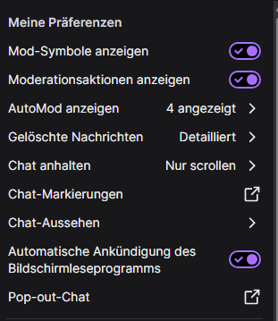

Damit lassen sich je nach Berechtigung und Kontext Aktionen wie das Entfernen einer Nachricht, eine Verwarnung, ein Timeout oder eine Sperre direkt aus dem Chat heraus erreichen. Ein Klick ist schnell; eine Entscheidung sollte trotzdem überlegt sein.

### Drei Schnellzugriffe unter dem Chat

- **Schild:** Abwehrmodus/Shield Mode aufrufen.
- **Schwert:** In die separate Mod-Ansicht wechseln.
- **Zahnrad:** Chat-Einstellungen öffnen.

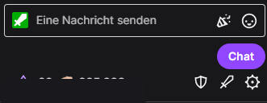

Weitere Optionen sind etwa die Anzeige von AutoMod-Nachrichten, gelöschten Nachrichten oder Chatdarstellung und Chatmodi. Sie müssen nicht alle genutzt werden.

## 5. Chatbefehle als Werkzeug

Chatbefehle werden direkt in das Eingabefeld geschrieben. Die Mod-Ansicht muss dafür **nicht** geöffnet werden. Im PC-Browser erscheint nach Eingabe von `/` eine scrollbare Liste von Befehlen mit Erklärungen.

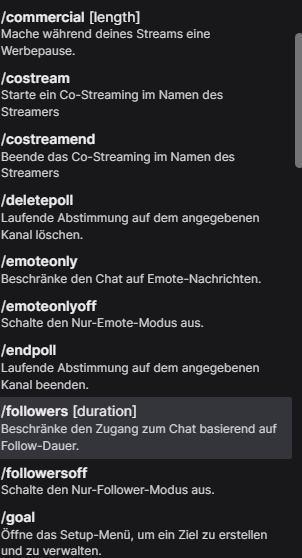

**Beispiele** (Platzhalter wie `NAME` oder `SEKUNDEN` durch echte Werte ersetzen):

| Befehl | Funktion |
|---|---|
| `/warn NAME GRUND` | Verwarnung aussprechen |
| `/timeout NAME SEKUNDEN GRUND` | Benutzer zeitweise vom Schreiben ausschließen |
| `/untimeout NAME` | Timeout aufheben |
| `/ban NAME GRUND` | Chat-Sperre aussprechen |
| `/unban NAME` | Chat-Sperre aufheben |
| `/clear` | Sichtbaren Chatverlauf für Nicht-Moderatoren leeren |
| `/slow SEKUNDEN` und `/slowoff` | Slow-Modus aktivieren bzw. ausschalten |
| `/followers ZEIT` und `/followersoff` | Follower-Modus aktivieren bzw. ausschalten |
| `/subscribers` und `/subscribersoff` | Nur-Abonnenten-Chat ein-/ausschalten |
| `/emoteonly` und `/emoteonlyoff` | Nur-Emotes-Chat ein-/ausschalten |
| `/shield` und `/shieldoff` | Abwehrmodus ein-/ausschalten |
| `/user NAME` | Nutzerinformationen aufrufen |
| `/raid KANAL` | Raid vorbereiten bzw. starten, soweit erlaubt |
| `/shoutout NAME` | Kanal im Chat hervorheben |
| `/mods`, `/vips` | Moderatoren bzw. VIPs anzeigen |

Weitere in der Twitch-Oberfläche angezeigte Befehle umfassen unter anderem `/announce`, `/monitor`, `/unmonitor`, `/restrict`, `/unrestrict`, `/poll`, `/prediction` und `/requests`. **Nicht jeder sichtbare Befehl ist für jede Rolle verfügbar.** Manche Aktionen benötigen Creator-Rechte, zusätzliche Berechtigungen oder einen passenden Kontext. Befehle und Syntax können sich ändern.

### PC und iPhone unterscheiden sich

Auf dem hier dokumentierten iPhone wurde bei der Eingabe von `/` im normalen Chat **keine entsprechende Befehlsliste** angezeigt. Dort muss man die Befehle kennen oder die mobile Mod-Ansicht verwenden. Im Browser am PC ist die Liste eine praktische Lern- und Gedächtnishilfe.

## 6. Die Mod-Ansicht am PC

Die Mod-Ansicht ist eine eigene, modular aufgebaute Moderationsoberfläche. Sie lässt sich unter anderem über das Schwert unter dem normalen Chat öffnen.

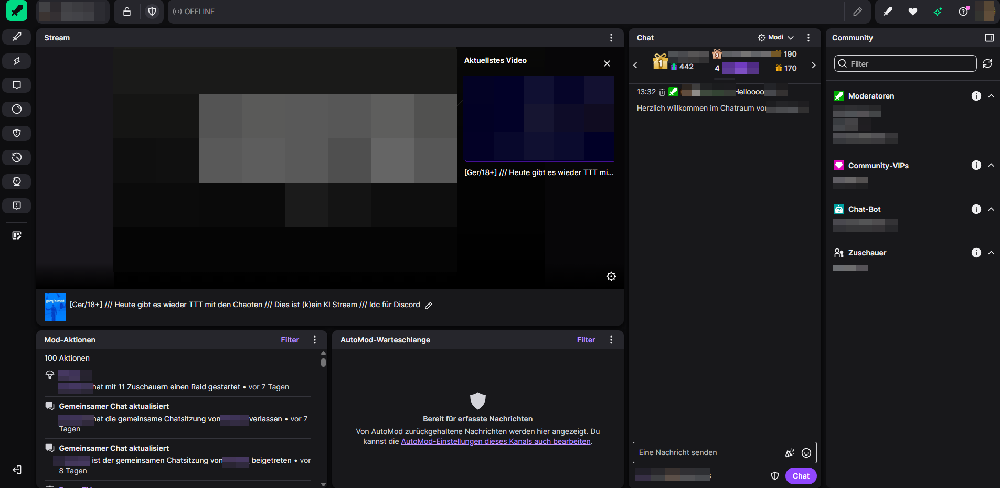

Je nach Layout können angezeigt werden: Stream-Vorschau, Chat, AutoMod-Warteschlange, Mod-Aktionen, Aktivitätsfeed, Benutzer- bzw. Community-Übersichten, Kanalpunkt-Anfragen und weitere Funktionen.

### Widgets anpassen

In der Mod-Ansicht können Widgets hinzugefügt, entfernt, umgeordnet und das Layout gespeichert werden. Das ist kein Selbstzweck: Wer nur den Chat betreut, braucht womöglich weniger Elemente als jemand, der parallel AutoMod-Anfragen und Aktivitäten verfolgt. Das Layout sollte zur tatsächlichen Arbeit passen.

### Benutzeraktionen direkt in der Community-Übersicht

In der Benutzerliste stehen je nach Rolle und Auswahl schnelle Aktionen zur Verfügung, etwa Verwarnen, Sperren, Timeout oder weitere Nutzer- und Kommunikationsfunktionen. Die exakte Bedeutung eines Symbols sollte man prüfen, bevor man es verwendet. **Mehrere Buttons bedeuten nicht, dass man sie immer braucht.**

### Kanalmodi direkt im Chatwidget

Ein Menü am Chatwidget erlaubt Schnellzugriffe auf Abwehrmodus, Abonnenten-, Emote-, Follower- und Slow-Modus sowie auf blockierte und zugelassene Begriffe.

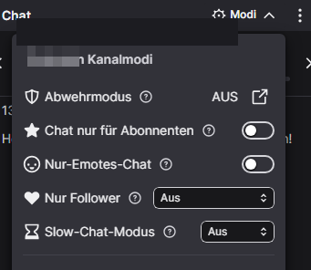

### Streaminformationen bearbeiten

Abhängig von den Freigaben können Titel, Kategorie, Tags, Sprache und Inhaltskennzeichnungen verwaltet werden. Solche Änderungen sollten zur Absprache mit dem Streamer passen.

## 7. Mod-Ansicht auf dem iPhone

Die iPhone-App bietet ebenfalls eine **deutschsprachige Mod-Ansicht**, auch wenn der Streamer offline ist. Die Bedienung erfolgt über eine kompakte, auf mobile Nutzung angepasste Darstellung.

Im dokumentierten Beispiel sind unter anderem Chat, schnelle Aktionen, AutoMod-Warteschlange, Mod-Aktionen, Vorhersagen und die Warteschlange für Kanalpunkt-Belohnungsanfragen verfügbar. Widgets lassen sich ein- oder ausblenden und umordnen. Die mobile Oberfläche ist **nicht eins zu eins identisch** mit dem PC-Layout.

Für schnelle Eingriffe unterwegs ist das hilfreich. Wer am Handy keine Liste der Slash-Befehle sieht, kann die Mod-Ansicht als Alternative nutzen. Eine längere, komplexe Moderationssituation ist am PC möglicherweise leichter zu überblicken.

## 8. Stream-Manager und Kanal-Dashboard

Neben der Mod-Ansicht gibt es den **Stream-Manager**. Er ist eher auf das Verwalten und Begleiten des Streams ausgerichtet. In einem individuell anpassbaren Layout lassen sich etwa Stream-Vorschau, Aktivitätsfeed, Chat und schnelle Aktionen kombinieren.

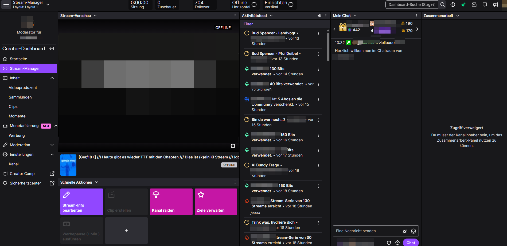

Dabei gibt es **keine ideale Widget-Anordnung für alle**. Jeder Moderator kann sein Layout an den eigenen Aufgaben ausrichten.

### Nicht jede Berechtigung ist automatisch vorhanden

Das Creator-Dashboard kann für Moderatoren weitere Bereiche anzeigen: Moderation und AutoMod, Analysen, Inhalte wie Clips oder Videos, Stream-Zeitplan und unter Umständen Werbeeinstellungen. Ob etwas **sichtbar, bedienbar oder änderbar** ist, hängt von Rolle und zusätzlichen Freigaben ab. Der Screenshot eines Stream-Managers zeigte beispielsweise auch einen Bereich, der ausdrücklich dem Kanalinhaber vorbehalten war.

**Wichtige Regel:** Technische Zugriffsrechte sind keine pauschale Erlaubnis, Einstellungen ohne Rücksprache zu verändern. Das gilt besonders für Werbung, Zeitplan und kanalweite Regeln.

## 9. AutoMod, Regeln und Kanalmodi

AutoMod hält potenziell problematische Nachrichten zur Prüfung zurück. Je nach Einstellungen können Moderatoren diese kontrollieren und die zugrunde liegenden Filter anpassen. Kategorien wie Belästigung, Diskriminierung oder sexuelle Inhalte und zusätzliche Funktionen wie Smart Detection dienen der Vorfilterung. Die Bewertung einer konkreten Nachricht braucht trotzdem Kontext.

**AutoMod ist ein Hilfsmittel, kein Ersatz für menschliche Moderation.** Ein blockierter Begriff kann mehrdeutig sein; eine Meldung ist nicht automatisch ein Regelverstoß. Umgekehrt können schädliche Nachrichten auch durch Filter rutschen.

### Kanalmodi mit Augenmaß

- **Slow-Modus:** Kann bei hohem Chattempo helfen.
- **Follower-Modus:** Kann neue Chatteilnehmer zeitweilig einschränken.
- **Nur-Abonnenten- oder Nur-Emotes-Chat:** Greifen stärker in die Beteiligung ein und sollten bewusst eingesetzt werden.
- **Abwehrmodus:** Für schnelle Schutzmaßnahmen bei ernsten Störungen oder Angriffen.

Eine pauschale Verschärfung kann auch unbeteiligte Zuschauer treffen. Wenn der Anlass vorbei ist, sollten temporäre Einschränkungen überprüft und nach Möglichkeit zurückgenommen werden.

## 10. Community, Lurker, Bots und Botlisten

### Lurker sind wichtige Zuschauer

Wer still zusieht oder zuhört, ist nicht automatisch inaktiv. Menschen können für Minuten oder Stunden lurken, zwischenzeitlich etwas schreiben und dann wieder still zuschauen. **Schweigen im Chat ist kein Hinweis auf Botting.** Lurker sind vollwertige Zuschauer und gehören zur Community.

### „Bot“ ist nicht automatisch „schädlich“

Es gibt nützliche Dienst- und Moderationsbots, automatisierte Accounts mit unterschiedlichen Aufgaben, unbekannte Bots und tatsächlich schädliche Spam- oder Angriffsbots. Auch bei Accounts in Listen muss man differenzieren: Ein Treffer ist ein Anhaltspunkt, kein automatischer Bann-Grund.

### Seiten, die wir als Werkzeuge und Vergleichsquellen betrachten

| Seite | Wofür sie interessant ist |
|---|---|
| [Twitch Insights](https://twitchinsights.net/bots) | Statistiken und Listen zu auffälligen oder automatisierten Accounts |
| [Twitch Bot Directory](https://twitchbots.info/) | Überblick über Bot-Accounts und deren Einordnung |
| [CommanderRoot Twitch Tools](https://twitch-tools.rootonline.de/) | Werkzeuge zur Untersuchung und Verwaltung von Followern |
| [Streams Charts: Bots](https://streamscharts.com/tools/bots) | Datenbasierte Untersuchung auffälliger Chat- und Bot-Aktivität |
| [ISDS Viewerliste](https://isds.tech/viewerliste/) | Zusätzliche deutschsprachige Perspektive auf Viewer- und Botlisten |

Externe Seiten können sich ändern und fehlerhafte Einträge enthalten. **Keine Massenbanns allein aufgrund einer Liste.** Prüfe Verhalten, Kontext, mögliche Fehlklassifikationen und die Regeln des Kanals.

## 11. Followbotting, Viewbotting und Angriffe

Dieses Kapitel fasst die bislang gemeinsam festgehaltenen Grundprinzipien zusammen. Eine frühere ausführliche Botting-Ausarbeitung soll bei einer späteren Überarbeitung vollständig eingearbeitet werden.

### Begriffe unterscheiden

**Followbotting** bezeichnet künstlich erzeugte Follows, **Viewbotting** künstliche Zuschaueraktivität. Beides kann von Dritten gegen den Willen eines Streamers ausgelöst werden. Auffällige Zahlen allein beweisen daher nicht, dass ein Kanal selbst manipuliert.

### Verhalten bei einem vermuteten Angriff

1. **Situation prüfen:** Ist es ein sprunghafter Follow-Anstieg, Spam, ein Hate-Raid oder nur eine ungewöhnliche, aber echte Aktivität?
2. **Bei akuter Störung schützen:** Beispielsweise Abwehrmodus aktivieren, gegebenenfalls Chatmodi vorübergehend anpassen.
3. **Alerts kontrollieren:** Wiederholte Benachrichtigungen bei Bedarf pausieren, damit der Stream nutzbar bleibt.
4. **Dokumentieren:** Uhrzeit, sichtbare Entwicklungen, Chatverlauf und getroffene Maßnahmen festhalten, ohne unnötig persönliche Daten zu veröffentlichen.
5. **Gemeinsam beurteilen:** Mit dem Streamer und dem Moderationsteam besprechen, ob weitere Schritte sinnvoll sind.
6. **Nachbereiten:** Einschränkungen zurücknehmen, betroffene Accounts sorgfältig prüfen, Meldungen und gegebenenfalls Twitch-Support nutzen.

Werkzeuge wie CommanderRoot oder Sery_Bot können hilfreich sein. Bei Follower-Entfernungen und automatisierten Maßnahmen gilt besondere Vorsicht: Irreversible oder breit angelegte Eingriffe können echte Menschen treffen.

**Leitgedanke: Kontrolle statt Aktionismus.**

## 12. Praxisbeispiele und Verhältnismäßigkeit

| Situation | Erste Überlegung | Mögliche Reaktion |
|---|---|---|
| Jemand widerspricht dem Streamer sachlich | Andere Meinung oder tatsächliche Störung? | Gespräch zulassen, bei Bedarf freundlich moderieren |
| Ein Smiley `;)` wird verschieden verstanden | Kontext, Wiederholung, betroffene Person? | Nicht pauschal sperren; bei tatsächlicher Belästigung reagieren |
| Moderator ist selbst im Streit | Bin ich noch neutral? | Zurückziehen, anderes Teammitglied übernehmen lassen |
| Sehr viele stille Zuschauer | Warum sollte Schweigen verdächtig sein? | Nicht pauschal als Bots einstufen |
| Plötzlicher Spam oder Hate-Raid | Aktive Gefährdung des Chats? | Schutzmaßnahmen zügig, verhältnismäßig und vorübergehend einsetzen |
| Auffälliger Follower-Anstieg | Gibt es unabhängige Anzeichen für Manipulation? | Dokumentieren, prüfen, nicht vorschnell beschuldigen |
| Ungefragte Raid-Werbung | Hat jemand um Empfehlungen gebeten? | Freundlich auf Kanalregeln und Kontext verweisen |

**Moderation heißt nicht, immer die härteste verfügbare Maßnahme zu verwenden.** Sie heißt, die Situation zu verstehen, Grenzen zu schützen und Verantwortung für die Auswirkungen zu übernehmen.

## 13. Quellen und Weiterführendes

Offizielle Dokumentation:

- [Twitch Mod View](https://help.twitch.tv/s/article/mod-view)
- [Twitch Chat Commands](https://help.twitch.tv/s/article/chat-commands)
- [Twitch Safety](https://safety.twitch.tv/)
- [Twitch Help Center](https://help.twitch.tv/)

Zusätzliche Bot- und Moderationswerkzeuge stehen in [Kapitel 10](#10-community-lurker-bots-und-botlisten). Die Verfügbarkeit, Bedienung und Berechtigung für einzelne Funktionen können sich ändern. Die Screenshots sind Anwendungsbeispiele und keine verbindliche Beschreibung jedes Twitch-Kontos.

---

## Erweiterte Bildansichten

Hier stehen zusätzliche Bilder zu den zuvor erklärten Funktionen. **Diese Sammlung ist zum Nachschlagen gedacht; im Haupttext erscheinen nur die für das Verständnis wichtigsten Screenshots.**

### A. Normaler Chat und Einstellungen

**Normale Chat-Einstellungen:** Manche Optionen betreffen die persönliche Darstellung, nicht die Moderation des gesamten Kanals.

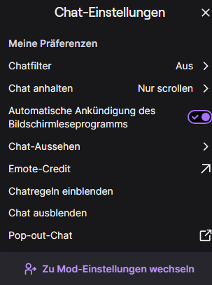

**Weitere Moderationsaufgaben:** Raids, Anfragen und der Wechsel zu Nicht-Mod-Einstellungen erscheinen zusätzlich im Einstellungsmenü.

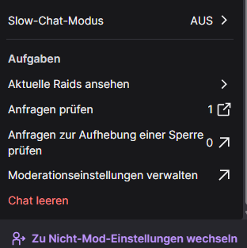

### B. Mod-Ansicht und Widgets

**Widgets hinzufügen oder verschieben:** Die Mod-Ansicht wird nach den eigenen Aufgaben zusammengestellt.

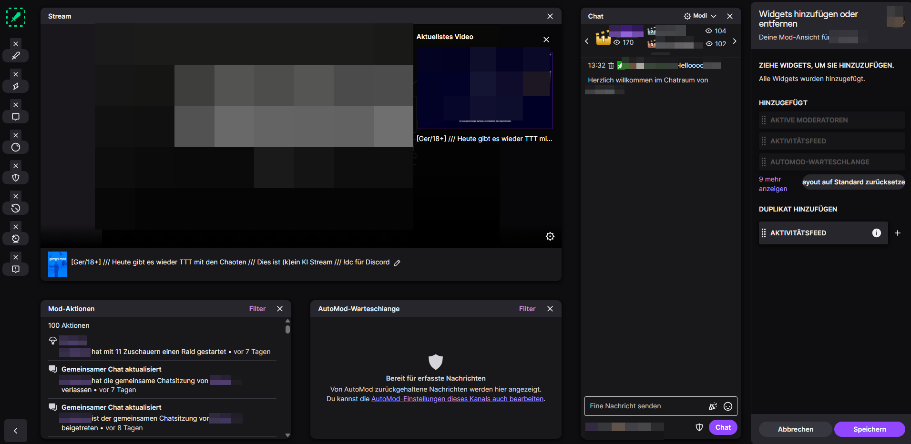

**Community-Aktionen:** Je nach Auswahl stehen verschiedene direkte Aktionen zur Verfügung. Zur Sicherheit sind identifizierende Namen abgedeckt.

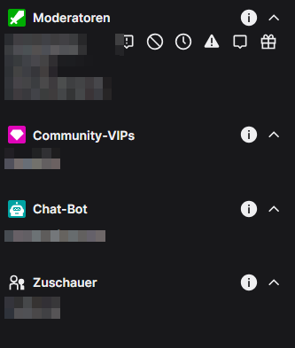

**Streaminformationen:** Berechtigte Moderatoren können unter anderem Titel, Kategorie, Tags und Sprache bearbeiten.

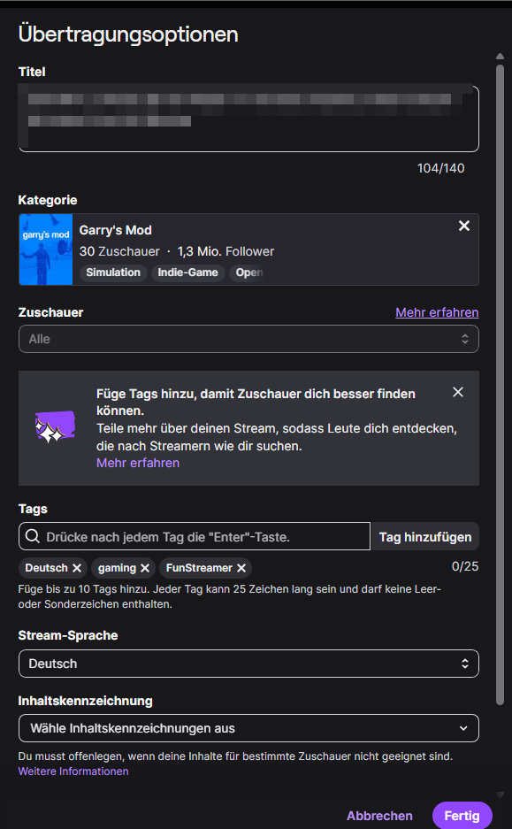

**AutoMod-Warteschlange:** Hier erscheinen Nachrichten, die eine Prüfung erfordern. Die Warteschlange kann auch einen Verweis zu weiterführenden Moderationseinstellungen enthalten.

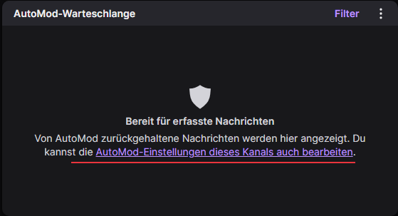

### C. Dashboard und Berechtigungen

**AutoMod-Konfiguration:** Kanalweite Filter, Chatberechtigungen und weitere Regeln werden im Dashboard verwaltet, sofern Zugriffsrechte vorhanden sind.

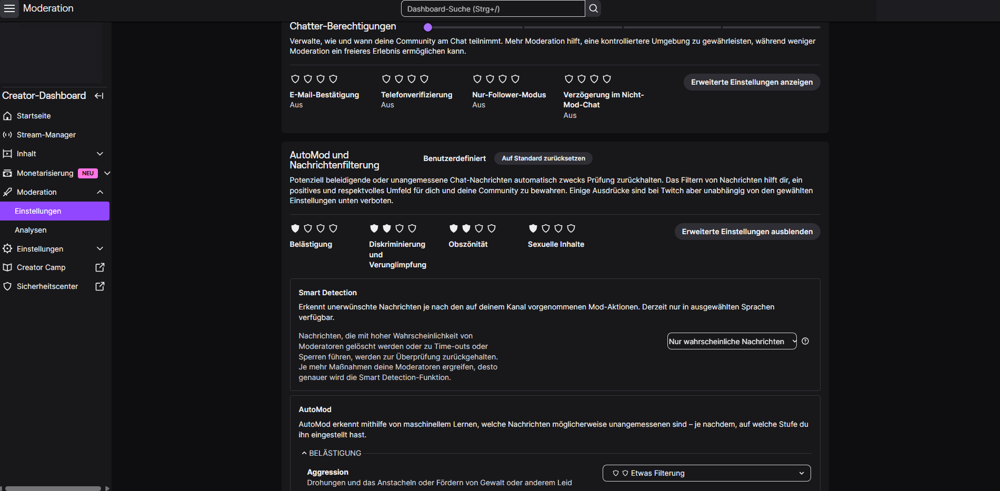

**Werbeeinstellungen:** Ein Beispiel für weitreichende, nicht selbstverständlich für jeden Moderator verfügbare Dashboard-Funktionen.

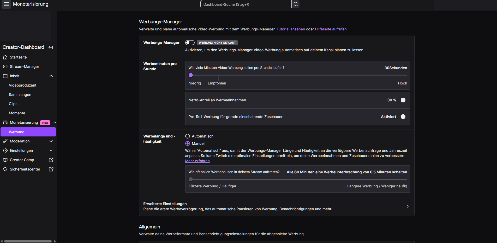

**Zeitplan:** Auch der Kanalzeitplan kann abhängig von den vorhandenen Berechtigungen zugänglich sein.

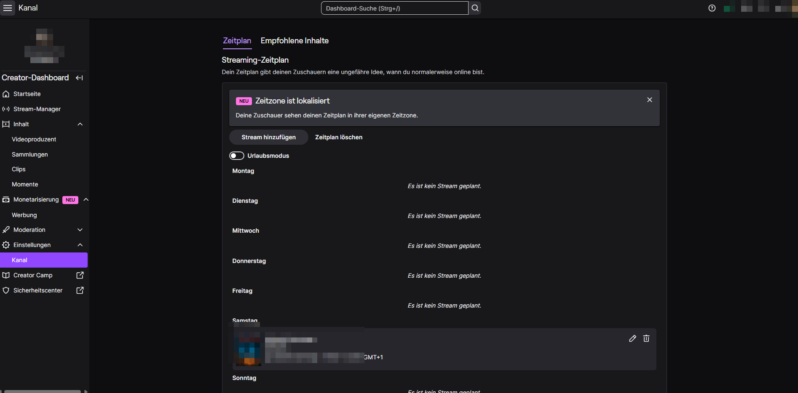

### D. Weitere Chatbefehle

**Mehr Chatbefehle im PC-Browser:** Über `/` lassen sich zusätzliche Aktionen samt Erklärung finden.

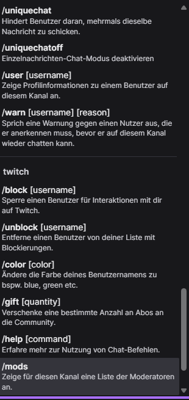

### E. Mobile Ansicht auf dem iPhone

**Schnelle Aktionen:** Die mobile Mod-Ansicht hält wichtige Funktionen als große Aktionsflächen bereit.

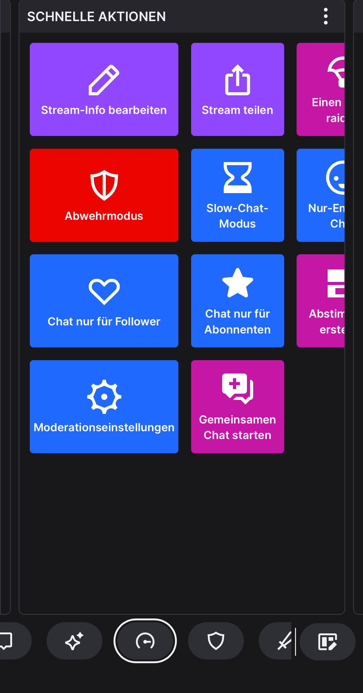

**Widgets verwalten:** Auch mobil können Elemente eingeblendet und sortiert werden.

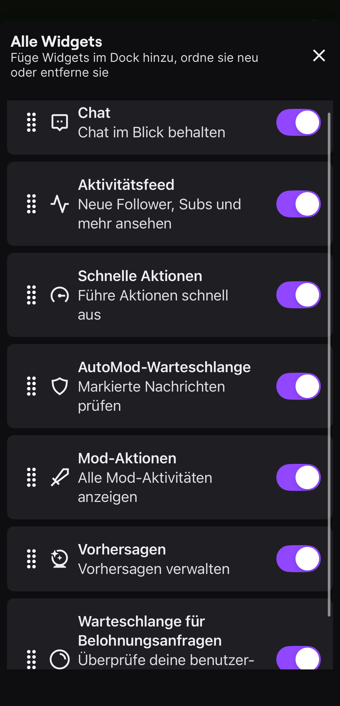

---

## Zur Entstehung

Die inhaltlichen Schwerpunkte, praktischen Beobachtungen und Beispiele stammen aus der laufenden Ausarbeitung des Leitfadens. Bei Strukturierung, sprachlicher Bearbeitung und Aufbereitung wurde KI unterstützend verwendet. Die Screenshots dienen der Erläuterung der Twitch-Oberflächen. Der Leitfaden soll Orientierung geben und keine Community zu einer einzigen Moderationsweise verpflichten.
